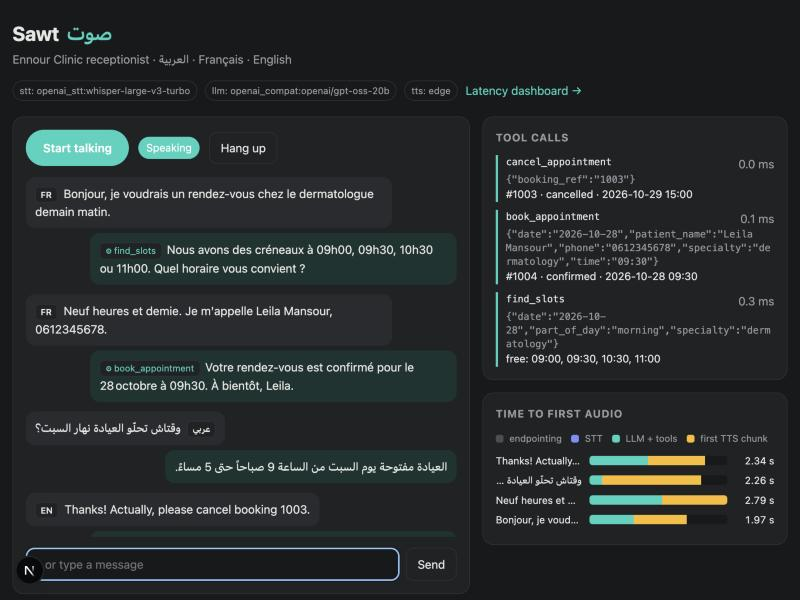
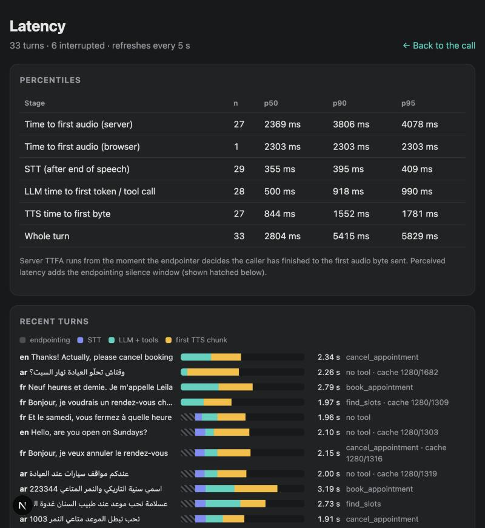
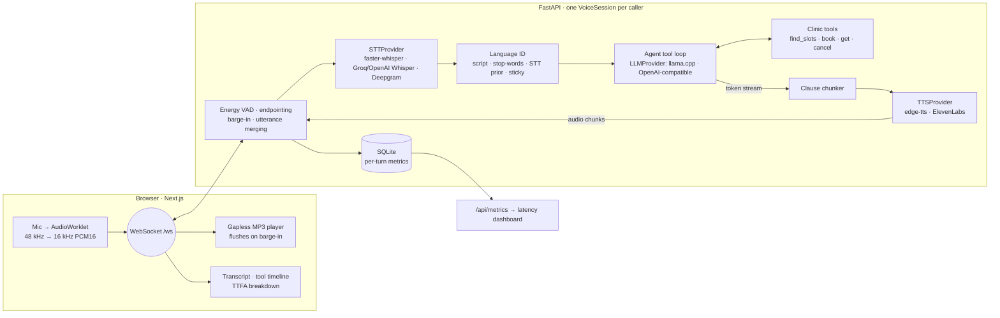

# Sawt · صوت — real-time multilingual voice agent

A phone-style voice receptionist for a (fictional) clinic in Tunis that understands and
answers in **Arabic** (Modern Standard, Tunisian Derja, Gulf), **French** and **English**,
books, looks up and cancels appointments through tool calls, and lets callers interrupt it
mid-sentence. Every turn is timed stage by stage, and a one-command eval suite checks
language ID, tool calls and task success on scripted multilingual conversations.



**Stack:** Python 3.12 · FastAPI WebSockets · asyncio · faster-whisper / Groq Whisper /
Deepgram · llama.cpp (GGUF) / any OpenAI-compatible LLM (Groq, Gemini, Ollama) ·
edge-tts / ElevenLabs · Next.js 16 + React 19 · SQLite · pytest · Vitest · Docker Compose ·
GitHub Actions · gitleaks.

## Results (measured, not estimated)

All numbers below come from runs in this repo; the raw JSON is committed under
[`evals/results/`](evals/results) and [`docs/benchmarks/`](docs/benchmarks). Runs are from
2026-10-27; their `commit` field is the last commit at run time, with the run's code
committed right after.

**End-to-end latency** — 23 caller utterances streamed in real time into the live server
over WebSocket (`make bench`), Groq `whisper-large-v3-turbo` + Groq `openai/gpt-oss-20b` +
edge-tts, server on a 2019 Intel i7-9750H laptop, free Groq tier:

| Stage (23 turns, 0 rate-limited) | p50 | p90 |
|---|---|---|
| STT, after the endpointer fires (Groq Whisper turbo) | 359 ms | 403 ms |
| LLM time to first token or tool call | 517 ms | 903 ms |
| TTS time to first byte (edge-tts) | 806 ms | 1,520 ms |
| TTS, first clause fully synthesised | 1,179 ms | 1,861 ms |
| **Server time to first audio** (endpoint → first audio byte sent) | **2.54 s** | **3.85 s** |
| **Caller-perceived**: end of speech → first audio byte at the client (incl. 550 ms endpointing) | **3.04 s** | **4.39 s** |

Time to first audio by language (p50): English 2.37 s · French 2.34 s · Arabic 2.88 s.
The largest single stage is **TTS** (edge-tts is a free, best-effort service), then
endpointing; the LLM is third. Raw data: [`docs/benchmarks/bench-groq-edge.json`](docs/benchmarks/bench-groq-edge.json).

Two things the benchmark surfaced:
- **6 of 23 utterances were split by the endpointer** at a pause between sentences
  ("Eleven is perfect. ‖ My name is…"). The session merged each pair back into one turn,
  because no answer audio had gone out yet. Latency is measured from the final endpoint.
- **Free-tier rate limits are real**: a first run without pauses spent up to 14 s of
  one turn in 429 back-off. The runner now records back-off separately and the published
  run pauses 10 s between conversations; 0 of 23 turns were throttled.

**Conversation evals** — 18 scripted conversations, 23 caller turns
(`make evals` / `make evals-audio`):

| Pipeline | Language ID | STT CER | Tool calls | FAQ answers | Reply language | Task success |
|---|---|---|---|---|---|---|
| Audio → Groq Whisper turbo → gpt-oss-20b (full path) | 100% | 3% | 96% | 100% | 100% | **94%** (17/18) |
| Text → gpt-oss-20b (Groq) | 100% | – | 100% | 100% | 100% | **100%** (18/18) |
| Text → Qwen2.5-1.5B-Instruct Q4 (local, CPU) | 100% | – | 61% | 100% | 96% | 61% (11/18) |

Per-language breakdown (full audio path): EN 100% · FR 100% · MSA 100% · Gulf 100% ·
code-switched FR/AR 100% · Tunisian Derja 67%. The one failure: «الساعة جوج ونص» ("half
past two" in Derja) was booked as 14:00 instead of 14:30.

**Local speech recognition** (faster-whisper on the same CPU, STT + language ID only,
`make evals-stt`):

| Model | Language ID | CER all | CER MSA | CER Tunisian | p50 latency |
|---|---|---|---|---|---|
| whisper `small` int8 | 100% | 5% | 9% | 5% | 3.7 s |
| whisper `base` int8 | 100% | 18% | 35% | 45% | 1.3 s |

`base` is fast but unusable for Arabic, which is why `small` is the local default and the
hosted Whisper turbo is the recommended path.



## How it works



A turn, from the caller's last word to the agent's first sound:

1. **Endpointing.** An adaptive-noise-floor energy VAD runs on 20 ms frames; 550 ms of
   silence ends the utterance. A 300 ms pre-roll is kept so the first syllable reaches STT.
2. **STT** runs on the buffered utterance (or streams it, with Deepgram).
3. **Language ID** combines script detection, a French/English stop-word vote, Arabizi
   tokens and the STT's guess, with short replies ("ok", "merci") keeping the call's
   current language.
4. **Agent.** The LLM streams; tool calls are executed against the clinic store and fed
   back; at most three tool rounds.
5. **Chunked TTS.** The token stream is cut at the first clause boundary (≥ 12 chars, comma
   included), so synthesis of the first clause starts while the model is still writing.
   A producer/consumer pair overlaps LLM generation and TTS.
6. **Playback** in the browser is gapless and in order; the client reports when audio
   actually started so browser-side time to first audio is measured too.

**Barge-in.** While the agent talks, the VAD needs 180 ms of speech (instead of 60 ms)
before it fires, to ignore coughs and echo leaks. When it fires, the server cancels the
turn task (the cancellation propagates into the LLM stream and the TTS request), the
client flushes its audio queue, and the partial answer is committed to history marked
`[interrupted by caller]`. If the caller resumes talking *before* any answer audio left,
the two utterances are merged into one turn and the abandoned turn is rolled back, so
a mid-sentence pause doesn't produce two half answers.

### Project layout

```
backend/src/sawt/
  providers/   base.py (STT/LLM/TTS protocols) + whisper, openai-compatible STT/LLM,
               deepgram, llama.cpp, edge/elevenlabs TTS, test fakes, registry
  pipeline/    session.py — VAD → STT → LID → agent → chunked TTS, barge-in, metrics
  agent/       tool loop, clause chunker, prompts + few-shot priming
  domain/      clinic store (deterministic slots), tools, trilingual facts
  audio/       VAD, decoding        language.py   language ID
  metrics/     SQLite turn store + percentiles        api/   FastAPI app
  evals/       scenario schema, scoring, runner, fixture synthesis, CLI
  bench.py     real-time WebSocket latency benchmark
evals/         scenarios.yaml, 23 audio fixtures, committed results
frontend/      Next.js call UI + latency dashboard
```

## Design decisions and trade-offs

- **Own pipeline instead of Pipecat / LiveKit Agents.** Those frameworks are the right
  call for production telephony, but the point here is to show the mechanics: endpointing,
  cancellation semantics, chunking and where the milliseconds go. The provider protocols
  are small enough to port onto either framework.
- **WebSocket, not WebRTC.** One TCP connection, PCM16 up and MP3 chunks down, trivial to
  deploy and to benchmark headlessly. The cost is no built-in jitter buffer or packet-loss
  concealment, acceptable on broadband and not on a mobile network, where WebRTC is the
  right transport.
- **Static knowledge in the prompt, tools only for state.** Opening hours, prices,
  insurance and address were first a `clinic_info` tool. Small models simply answered
  those from their own priors, often wrongly: with the tool design, the local 1.5B model
  completed 17% of scenarios. After moving the trilingual facts into the system prompt and
  adding the few-shot demonstrations below, it completed 61%, with every FAQ answer
  correct. (The FAQ grading changed with the design, from "called the tool" to "said the
  right fact", so the two numbers are not a pure ablation.) It also removes a whole LLM
  round from FAQ turns and costs nothing per turn, because the prefix is cached.
- **Prompt-prefix caching.** The system prompt, tool schemas and few-shot examples are
  fixed for the day, so llama.cpp reuses its KV cache for them and each turn only pre-fills
  the caller's words. In a local run, a follow-up round reused 868 of 931 prompt tokens.
  The server primes this cache at start-up.
- **Few-shot tool demonstrations, fenced off.** Three worked tool-call exchanges sit in the
  cached prefix between "examples" and "a new caller is on the line" markers. Their
  phrasings, specialties and booking numbers differ from the eval set (a unit test enforces
  this), to avoid grading the model on its own examples.
- **Voice-friendly tool signatures.** Callers say times and numbers, so tools take
  `specialty + date + time` rather than opaque slot ids, and booking references accept
  "ENR 1002", "1002" or Arabic-Indic "١٠٠٢". Error messages list the free alternatives, so
  the model can recover in one round.
- **Single-pass Whisper.** `faster-whisper`'s `transcribe(language=None)` runs the encoder
  once to detect the language and again to decode. Detecting from the same encoder output,
  and restricting the choice to ar/fr/en (Maghrebi Arabic is otherwise often labelled
  Maltese or Persian), halved local STT time on a 5 s clip: 6.0 s → 3.0 s for `small`.
- **Language ID is mostly text-based.** On 1-3 s clips the STT's language guess is noisy;
  script + stop-words is deterministic and was right on all 23 eval turns. The STT guess
  is only a tie-breaker.
- **Rate limits are measured, not hidden.** On Groq's free tier, 429 back-off is tracked
  separately (`llm_throttled_ms`), so latency figures report model time and the eval
  report states how long was spent waiting (257 s across the audio eval run).

## Run it

Requirements: Python 3.11–3.12 with [uv](https://docs.astral.sh/uv/), Node 22.

```bash
make setup                      # backend (all providers) + frontend deps
cp .env.example backend/.env    # optional: add GROQ key, pick providers
make models                     # only for the fully local LLM (~1 GB GGUF)
make dev-backend                # :8000
make dev-frontend               # :3000, then open http://localhost:3000
```

Provider presets (`backend/.env`):

| Setup | Variables | Notes |
|---|---|---|
| Hosted, fast (measured above) | `SAWT_STT=openai_stt` `SAWT_LLM=openai_compat` `SAWT_OPENAI_API_KEY=<groq key>` | free Groq tier works, with rate limits |
| Fully local, no keys | defaults (`whisper` + `llamacpp`) | runs offline except edge-tts; slow on CPU (see below) |
| Streaming STT | `SAWT_STT=deepgram` `SAWT_DEEPGRAM_API_KEY=…` | implemented, not benchmarked here |
| Premium TTS | `SAWT_TTS=elevenlabs` `SAWT_ELEVENLABS_API_KEY=…` | implemented, not benchmarked here |

Or with Docker: `make models && docker compose up --build`.

### Checks, evals and benchmarks

```bash
make check         # ruff, ruff format, mypy --strict, tsc, 61 pytest + 4 vitest tests
make evals-stt     # STT + language ID on the audio fixtures (no LLM)
make evals         # agent on scripted conversations (text in)
make evals-audio   # audio fixtures → STT → language ID → agent → state checks
make bench         # real-time latency benchmark against a running backend
```

Each eval run writes `evals/results/<mode>-<stage>[-tag].{json,md}` with per-turn
transcripts, tool calls, replies and the failed cases; `--min-score` makes it a CI gate.
CI runs lint, types, tests, the frontend build, gitleaks and the STT eval on every push;
the slower local-LLM agent eval runs weekly, on demand, or with an `evals` PR label.

## Limitations

- **Synthetic test speech.** The 23 audio fixtures are edge-tts voices (other voices than
  the agent's own, including Tunisian and Emirati ones) with clean audio. Real phone audio,
  accents and background noise will raise CER; the numbers are an upper bound.
- **Small eval set.** 18 conversations and 23 turns. Enough to catch regressions and to
  compare configurations, too small for fine-grained claims. FAQ answers are graded by
  keywords, not by an LLM judge.
- **Tunisian Derja** relies on a small glossary in the prompt; numbers and times spoken in
  dialect («جوج ونص») are still a failure mode.
- **Local CPU path is slow.** On the 2019 Intel laptop used here, local Whisper `small`
  takes 3-4 s per utterance and the 1.5B LLM several seconds per round, so the fully
  local mode is a no-key demo and a privacy option, not a real-time configuration. Apple
  Silicon or a GPU changes this; not measured here.
- **Not measured:** Deepgram streaming STT and ElevenLabs TTS (no keys available),
  `docker compose` (no Docker on the build machine) and the GitHub Actions workflow (not
  yet pushed). gpt-oss-120b was tried but hit the free tier's organisation rate limit, so
  no result is reported for it.
- **One process, shared models.** A single llama.cpp instance serves all sessions behind a
  lock, so concurrent local callers queue. Hosted providers do not have this limit.
- The energy VAD is simple by design; a neural VAD (Silero) and a semantic end-of-turn
  model would cut the 550 ms endpointing window, which is the largest fixed cost of a turn.

## License

MIT
